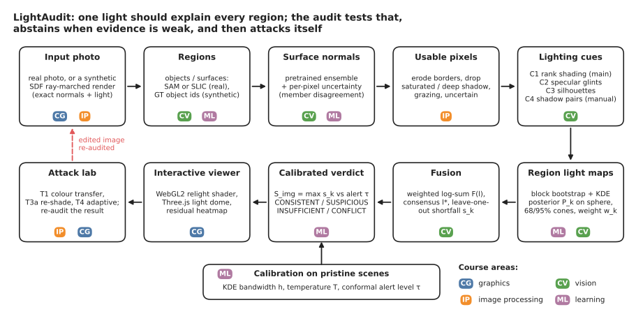
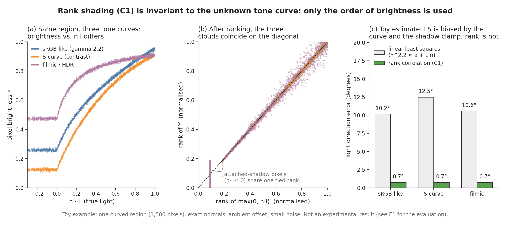
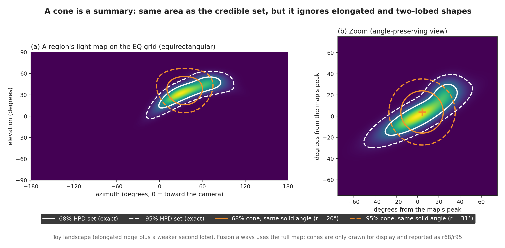
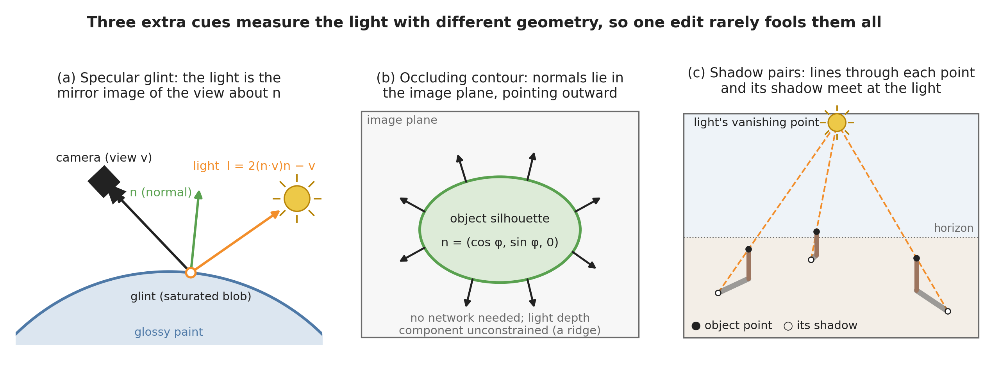
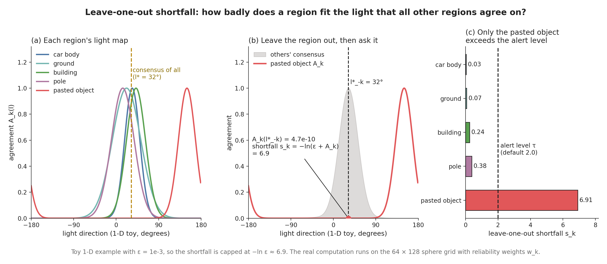
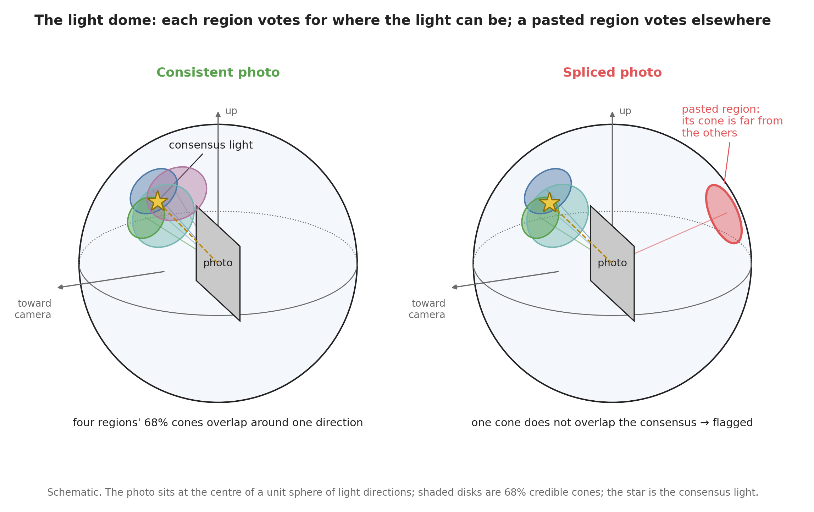
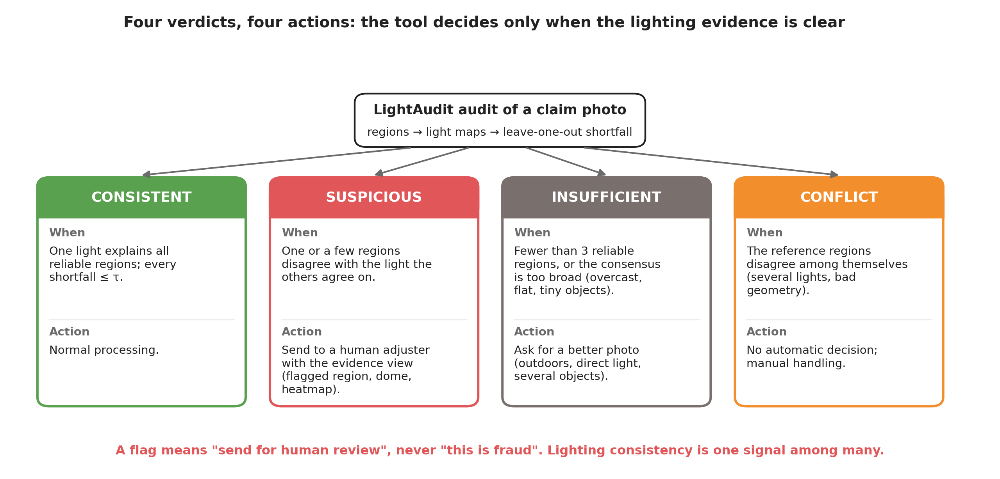
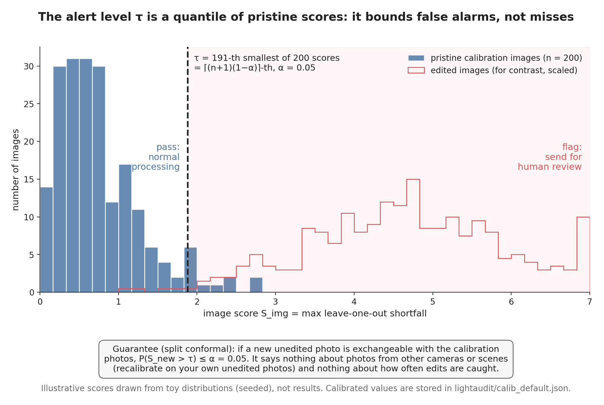
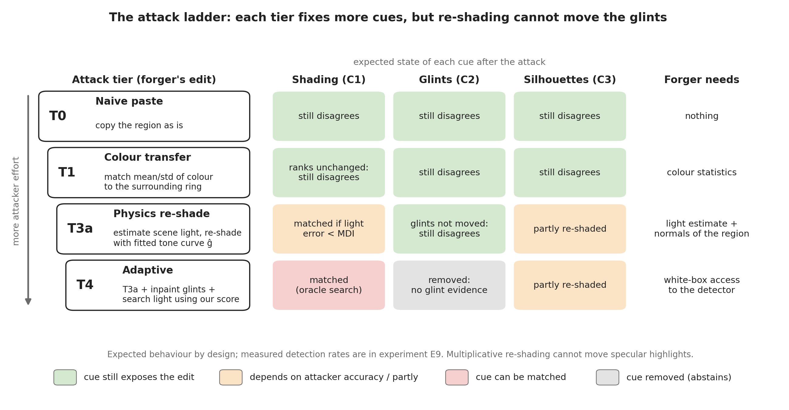

# LightAudit — Method

This document describes what LightAudit computes, with the equations, the default parameters and the reason for each design choice. It covers the core library (`lightaudit/`), the calibration, the attacks and the shading used in the viewer. Experimental results are not reported here; they are in the report and in `data/results/`. Calibrated parameter values (KDE bandwidth `h`, temperature `T`, alert level `τ`) are stored in `lightaudit/calib_default.json` and are not repeated here, because they change whenever calibration is re-run.

What the method claims: it tests whether **one distant light can explain the shading of all reliable regions** of a photo. It does not detect AI-generated images, and it does not detect fraud. A SUSPICIOUS verdict means "send for human review". See `LIMITATIONS.md`.



*Figure I1. Pipeline. Tags mark the course area each stage belongs to (CG graphics, CV vision, IP image processing, ML learning).*

---

## 1. Conventions

Most bugs in this kind of system are sign and axis errors, so the conventions are fixed once and used everywhere (Python and JavaScript).

**Camera space.** `+x` right, `+y` up, `+z` toward the viewer (out of the screen). A visible surface has `n_z > 0`.

**Pixels and rays.** Pixel `(u, v)` with `u` right and `v` down. Pinhole camera, principal point at the image centre `(c_x, c_y)`, horizontal field of view `fov` (default 60°), square pixels:

```
f = (W/2) / tan(fov/2)
d = normalize([ (u − c_x)/f,  −(v − c_y)/f,  −1 ])      # ray direction
v_cam = −d                                               # view vector, surface → camera
```

**Light direction** `l` is the unit vector from the surface point *toward* the light. The full sphere is allowed: back-lit and behind-the-camera lights are legal.

**Normal maps** are stored as `RGB = round((n + 1)/2 · 255)`.

**Intensity.** `Y = 0.2126 R + 0.7152 G + 0.0722 B` on sRGB-encoded values in `[0, 1]`. The rank cue does not need linear values. Where a linear value is needed (the synthetic renderer and the least-squares baseline) gamma 2.2 is used and this is stated in the code.

### 1.1 The EQ grid

Every light map lives on one equirectangular grid of `N_A = 128` azimuth columns × `N_E = 64` elevation rows (8192 directions). For row `j` (top = up) and column `i`:

```
az  = −π + (i + 0.5) · 2π / 128        # 0 = +z (toward the viewer), +π/2 = +x (right)
lat =  π/2 − (j + 0.5) · π / 64        # +π/2 = +y (up)
x = cos(lat) sin(az),   y = sin(lat),   z = cos(lat) cos(az)
area_weight[j] ∝ cos(lat)             (normalised to sum to 1)
```

Arrays are `[64, 128]`, row-major, flattened as `k = j·128 + i`. A shared test-vector file checks that Python and JavaScript agree. A coarse grid (every 4th cell in both axes, 16 × 32 = 512 directions) is used inside the bootstrap, followed by local refinement on the full grid.

*Why a fixed grid:* the posterior of a single region is often not a blob (it can be a ridge or have two lobes, see Figure I5). A grid represents any shape, fusion becomes element-wise arithmetic that is trivial to mirror in the browser, and the dome shader can sample the same array as a texture. 8192 cells give a cell size of about 2.8°, well below the angular uncertainty of any region.

Display angles: azimuth `atan2(x, z)` (clockwise from the camera direction when seen from above) and elevation `asin(y)`.

---

## 2. Regions and usable pixels

**Regions** (`regions.py`) are object or surface masks. Backends: ground-truth object ids (synthetic data; used in all large experiments), SAM (optional, real photos), SLIC superpixels merged by colour and normal similarity (always-available fallback), and manual label maps. In **panel mode** a user-supplied ROI (e.g., a dent) becomes its own region, together with a ring around it on the same panel, and both are removed from the parent region. Sky (touches the top border, bright, low variance), mostly saturated regions and regions under 800 px are excluded automatically; the user can toggle exclusion in the viewer.

**Usable pixels** (`validity.py`). A pixel of region `k` is used by the shading cue only if all hold:

1. it lies inside the region mask eroded by `erode_px = max(3, round(0.008 · min(H, W)))` (normals are unreliable at boundaries);
2. `0.04 ≤ Y ≤ 0.97` (not deep shadow, not saturated; saturated pixels go to the glint cue);
3. `n_z ≥ 0.05` and normal uncertainty `≤ 35°`.

If more than `N_max = 2500` pixels remain they are subsampled with a stratified spatial scheme (one random pick per cell of a regular grid, seeded per region), keeping pixel coordinates for the block bootstrap. With fewer than `N_min = 150` pixels the region gets weight 0 ("too few usable pixels").

---

## 3. Surface normals and their uncertainty

Synthetic experiments use exact normals or `noisy_gt(σ)`, a simulation of a normal predictor: each ground-truth normal is rotated by a spatially smooth random field (std `σ` per axis, default 8°), and with probability 0.15 per object a gross-error patch tilted by about 40° is added near the object boundary. Its uncertainty map is the disagreement between two independent noisy copies, floored at 4°.

On real photos, `predict_normals` runs every available pretrained backend (DSINE, StableNormal, Marigold; Depth Anything as a last resort), resamples them to the image, and fuses them:

```
n_fused = normalize(mean_m n_m)
unc     = max(4°, mean_m angle(n_m, n_fused))      # single backend: 12° constant (+ small texture term)
```

Backends disagree on axis directions, so each output passes a convention check that tests axis flips against two image priors: the bottom 15% of rows (usually ground) should face up (`y > 0`) and the median normal should face the camera (`z > 0`). The decision is logged; `--flip-x/y/z` override it.

*Why an ensemble:* member disagreement is a cheap uncertainty signal. It is used to discard pixels, to size the bootstrap perturbation, and in the residual z-score. It underestimates the true error when members share training data (see Caveats).

---

## 4. Cue C1 — shading

> **Changed after evaluation.** The default shading cue is now a least-squares fit (`Config.cue = "ls"`):
> the light maximises the Pearson correlation between `max(0, n·l)` and the linearised luminance `Y^2.2`
> (`lightaudit/cues/ls_baseline.py`). The rank cue described in the rest of this section was the original
> proposal; it measured about three times less accurate (it discards brightness magnitudes, which hurts on
> shapes with few distinct normals) and is kept as the evaluated baseline (`cue = "rank"`). Everything
> downstream (bootstrap, KDE posterior, fusion, calibration) is identical for both cues.

### 4.1 The original rank cue (baseline)

**Model.** Inside one region (one material, roughly constant albedo):

```
Y_i = g( max(0, n_i · l) )          with g unknown and monotone non-decreasing
```

`g` absorbs the camera response, gamma, global tone mapping, exposure, ambient offset and albedo scale. Only the *order* of brightness carries information about `l`.

**Landscape.** For a set of candidate directions `l` (rows of `L_dirs`):

```
s    = N_valid · L_dirsᵀ                    # (N, D)  n · l for every pixel and direction
rs   = column-wise ranks of max(s, 0), with all s ≤ 0 entries tied at the mean rank of that group
ry   = ranks of Y (ties → average rank)
S(l) = Pearson(rs[:, l], ry)                # Spearman correlation with ties handled
```

The tie handling matters: every pixel in attached shadow (`n·l ≤ 0`) has the same predicted value 0, and an arbitrary order among them would create fake structure. For a column with `z` entries `≤ 0` those entries get rank `(z − 1)/2`, the others get their ordinary rank.

Per-region summaries: `ρ_max = max S`, its argmax, `spread_deg` (90th percentile of the angle between each valid normal and their mean), and `sharp_area` (solid-angle fraction with `S ≥ ρ_max − 0.05`).



*Figure I2. Toy example: the same region under three tone curves. (a) Brightness against `n·l` differs per curve. (b) After ranking the three point clouds coincide. (c) A linear least-squares fit of `Y^2.2 ≈ a + L·n` is biased by the curve and by the shadow clamp; the rank estimate is not. Toy data, not an experimental result.*

**Why this cue.**

- The classic approach linearises the image and fits `Y_lin ≈ a + L·n` by least squares. That assumes known radiometry, linear shading and a known albedo scale, none of which hold for phone photos with HDR tone mapping. A rank statistic is invariant to every monotone `g`, so these assumptions are not needed.
- It is the maximum-rank-correlation estimator for a single-index model (Han 1987), applied to the index `n·l`.
- It is a **half-space voting** method: each pair of pixels with `Y_a > Y_b` says that the light lies in the half-sphere where `n_a·l > n_b·l`. This links it to the constraint view of Kee, O'Brien & Farid, with their linear radiometric model replaced by an unknown monotone curve.
- The cost of invariance: absolute brightness information is discarded, so regions with a narrow range of normals constrain the light less than a linear model would (if the linear model were correct). The reliability weight (section 7) accounts for this.

The least-squares baseline (`cues/ls_baseline.py`) uses the same posterior machinery with `S(l) = Pearson(Y^2.2, max(0, n·l))`, so the comparison isolates the cue.

---

## 5. Region posterior and credible cones

For each region, `posterior.py` builds a normalised map `P_k` on the EQ grid (max = 1) that describes where the light can be, plus summary cones.

1. **Exact landscape** `S_k` on the full grid from up to `N_exact` usable pixels (config; 1200 in the current implementation).
2. **Block bootstrap**, `B = 30` draws. The region's bounding box is tiled into square blocks of `block_px = 24` px (scaled with image size); a draw resamples blocks with replacement until it has at least 600 pixels. Normals are perturbed by a spatially smooth Gaussian field with per-pixel std `σ_draw = max(4°, unc)`, generated at 1/8 resolution and bilinearly upsampled, then renormalised. For each draw: coarse landscape on 512 directions → coarse argmax → refine over the 13 × 13 fine-grid window around it (wrapping in azimuth) → sample `l_b`.
3. **KDE posterior**:

   ```
   P_raw(l) = Σ_b exp( −θ(l, l_b)² / (2 h²) )
   P        = P_raw^(1/T),   then  P ← P / max P
   ```

   with `θ` the angle between directions, bandwidth `h` and temperature `T` set by calibration (section 10).
4. **Credible regions.** Sort cells by `P` descending and accumulate the area-weighted mass `P · area_weight`. The smallest sets reaching 68% and 95% of the mass (highest-density sets) have solid angles `Ω68`, `Ω95`. Each is summarised as a cone of the same solid angle, half-angle `r = arccos(1 − Ω / (2π))`, centred on the normalised mean of the bootstrap samples `l_b`.

Stored per region: `n_valid, spread_deg, ρ_max, sharp_area, center, r68, r95, P, S, cues_used, weight, reliable, reason`.

*Why bootstrap + KDE:* pixels inside a region are not independent (normal errors and albedo variations are spatially correlated), so a naive likelihood would be far too confident. Resampling spatial blocks and adding smooth normal noise gives a spread of estimates that reflects both effects. The KDE turns the samples into a map; `h` and `T` are then calibrated so that the 68% and 95% sets actually contain the true light about 68% and 95% of the time on calibration scenes.



*Figure I5. A cone is only a display summary. It has the same solid angle as the highest-density set but ignores elongated or two-lobed shapes. Fusion always uses the full map.*

---

## 6. Additional cues



*Figure I3. Geometry of the three additional cues.*

### 6.1 C2 — specular glints

Saturated pixels, discarded by C1, are informative on glossy paint: a highlight appears where the mirror direction of the view vector about the normal points at the light.

- Glint blobs: connected components of `Y > 0.97` with area between 4 px and 2% of the region, and local contrast `mean(Y_blob) − mean(Y in a 5-px ring of unsaturated pixels) ≥ 0.15`. Larger blobs are treated as white paint or sky reflections and rejected.
- Per blob: `n_h` = normalised mean normal over the blob dilated by 2 px, `v` = view vector at the blob centroid, and

  ```
  l_h = 2 (n_h · v) n_h − v
  σ_h = sqrt(σ_n² + σ_floor²),   σ_n = mean unc over the blob,  σ_floor = 8°
  A_glint(l) = mean over blobs of exp( −θ(l, l_h)² / (2 σ_h²) ),  normalised to max 1
  ```

The **mean** over blobs (not the product) is used so that the reflection of some other bright object cannot veto the sun direction. The cue enters fusion with weight `w_glint = 0.5`.

### 6.2 C3 — silhouette / occluding contour

At a true occluding contour the surface normal lies in the image plane, so it is known from 2D geometry alone, without a neural network. Boundary pixels 3–6 px inside the mask where the predicted normal is grazing (`n_z < 0.5`) and the contour orientation is stable get the geometric normal `n = (cos φ, sin φ, 0)`, with `φ` the outward 2D contour normal in camera axes (the image `v` axis is flipped to `y`). C1's `rank_landscape` is run on these pixels (at least 80 are required). Because `n_z = 0` for all of them, the depth component of `l` is unconstrained and the landscape is a ridge; that is expected and shown as is.

The rank landscape `S` (a correlation, not a probability) is mapped to `[0, 1]` by

```
A_contour(l) = exp( −(S_max − S(l)) / 0.1 )
```

and the cue is used only if `S_max ≥ 0.3` (a weaker best correlation means the contour shading does not follow the model). It enters fusion with weight `w_contour = 0.5`.

### 6.3 C4 — cast-shadow pairs (manual, experimental)

The user clicks an object point `p_j` and the image point `s_j` of its shadow, for at least two pairs. For a directional light, the 3D rays through each pair are parallel, so the image lines through `p_j, s_j` meet at the vanishing point of the light direction, `vp ∝ K · l` in homogeneous coordinates (with the camera-space sign convention of section 1 applied when projecting `l`). For a candidate `l` the residual of pair `j` is the distance from `vp(l)` to the line through `p_j, s_j`, normalised by the line length and a pixel uncertainty `σ_px = 3`:

```
A_shadow(l) = exp( −Σ_j r_j² / 2 ),   normalised
```

It enters fusion as a scene-level pseudo-region with weight 0.7 and is labelled experimental in the viewer.

---

## 7. Reliability weight

Each region gets five factors in `[0, 1]` and their geometric mean as its weight:

```
f_size   = clip(n_valid / 800, 0, 1)
f_spread = clip((spread_deg − 6) / (25 − 6), 0, 1)
f_sharp  = clip(1 − sharp_area / 0.5, 0, 1)
f_dir    = clip((ρ_max − 0.25) / (0.60 − 0.25), 0, 1)
f_norm   = clip(1 − (mean_unc − 10) / (30 − 10), 0, 1)
w        = (f_size · f_spread · f_sharp · f_dir · f_norm)^(1/5)
reliable = (w ≥ w_min) and not excluded,       w_min = 0.35
```

When a region is unreliable, the smallest factor names the reason shown to the user: "too few usable pixels", "surface too flat", "light direction poorly constrained", "weak directional shading (overcast/soft light?)", "normals unreliable".

*Why a geometric mean:* any single failing factor (e.g., a flat surface) should be able to pull the weight down on its own; an arithmetic mean would let four good factors hide one fatal one. `w_min` is fixed at 0.35, not tuned on test data.

---

## 8. Fusion, consensus, shortfall and verdict

All of this is mirrored exactly in `viewer/fusion.js`; a parity test compares both implementations on shared vectors.

**Combining cues within a region** (`ε = 1e-3`):

```
ln A_k(l) = ln(ε + P_k^{C1}(l)) + w_g · ln(ε + A_glint(l)) + w_c · ln(ε + A_contour(l))   (cues present only)
A_k = exp(ln A_k − max ln A_k)                                                            (max A_k = 1)
```

If only C1 is present, `A_k = P_k`. Scene-level cues (shadow pairs) are separate pseudo-regions.

**Consensus** over the set `R` of reliable regions with weights `w_j`:

```
F_R(l) = Σ_{j∈R} w_j · ln(ε + A_j(l)),      l*_R = argmax_l F_R(l)
```

This is a weighted product of the region maps (a log-linear pool). `ε` stops one region from setting the product to zero everywhere and caps the penalty a single region can impose at `−ln ε ≈ 6.9`.

**Leave-one-out shortfall** of region `k`:

```
l*_{−k} = argmax_l Σ_{j∈R, j≠k} w_j ln(ε + A_j(l))
s_k     = −ln(ε + A_k(l*_{−k}))          # 0 = agrees fully; at most −ln ε ≈ 6.9
angle_k = angle(center_k, l*_{−k})
```

Image score: `S_img = max_{k∈R} s_k`, with `k_top` the argmax.



*Figure I6. Leave-one-out shortfall on a 1-D toy example.*

*Why leave-one-out:* if the pasted region took part in the consensus it would pull the consensus toward itself and partly hide its own disagreement. Asking each region how well it fits the light that *the others* agree on removes that self-influence. Using `−ln A_k` at a single point (instead of, say, an overlap integral) keeps the score interpretable: `s_k = 2` means the region's map at the others' preferred light is `e^−2 ≈ 0.14` of its own peak.



*Figure I4. The same idea on the sphere, as shown in the viewer's light dome.*

**Verdict** (`τ = τ_img` from calibration, `τ_ref = τ_img · tau_ref_factor`, default factor 1.0):

1. **INSUFFICIENT** if fewer than 3 regions are reliable, or if the consensus is uninformative: the 95% highest-density set of the normalised consensus map `exp(F_R / Σw)` covers more than 35% of the sphere. The reason reported is the dominant cause.
2. **CONSISTENT** if `S_img ≤ τ`.
3. Otherwise the candidates are `C = {k : s_k > τ}`. The implementation then decides as follows:
   - If the reliable regions *not* in `C` number at least 2 and agree among themselves (their own leave-one-out maximum shortfall, computed among themselves only, is `≤ τ_ref`), the verdict is **SUSPICIOUS** and all candidates are flagged, sorted by `s_k`.
   - Otherwise, each candidate is tried alone, in descending order of `s_k`: if removing just that one region leaves the rest (at least 2 regions) mutually consistent (their leave-one-out maximum shortfall `≤ τ_ref`), the verdict is **SUSPICIOUS** with that single region flagged. This handles the case where one heavy outlier drags the leave-one-out consensus of the other regions, so that innocent regions also exceed `τ` in the first pass.
   - If neither test succeeds, the verdict is **CONFLICT**: the reference regions disagree among themselves (several lights or poor geometry), and no automatic decision is made.
4. A region that is unreliable is never flagged; it is listed under "regions that could not be assessed".

The spec asked for at least 3 remaining reference regions in step 3; the implementation accepts 2. With two references the agreement test is a single pairwise comparison, which is weaker evidence; the reported per-region shortfalls and angles let a reviewer judge this.

Outputs: verdict, `S_img`, `k_top`, per-region `{s_k, angle_k, flagged}`, the consensus direction with 68/95% cones (HPD sets of the normalised `exp(F_R / Σw)`), and the consensus map. The explanation text is generated by fixed templates from these numbers only (no language model).



*Figure I9. The four verdicts and the recommended action in an insurance-claim workflow.*

---

### 8.1 Two scene-level checks added after evaluation

Both are applied after the consensus fusion, in `fusion.fuse` (Python) and `viewer/fusion.js`.

**Soft-light abstention.** For every region, `contrast = P10 / P90` of the linearised luminance `Y^2.2` over its
non-saturated pixels. Under a sun the shadowed side of an object is several times darker than the lit side
(low ratio); under an overcast sky, or when everything visible is in shade, the ratio stays high. If the median
contrast over the reliable regions exceeds `soft_contrast`, the verdict is `INSUFFICIENT` ("the light looks
diffuse"), whatever the direction test says. Why: soft sky light shades a surface almost like a broad light
from above, so the direction test finds a consistent "up" and would otherwise call the scene consistent, and a
splice under such light is undetectable. `soft_contrast` is the split-conformal 95% quantile of the contrast of
sun-lit calibration scenes, so about 5% of sunny scenes are additionally sent to `INSUFFICIENT`.

**Panel residual (panel mode only).** A dent is small and shallow, so its own light estimate is too noisy to
test. Instead the ROI is compared with the panel it sits on, which has the same paint and the same light: fit
the monotone curve `g` (section 9) on the valid pixels of the ring and of the panel remainder under the panel's
own light estimate, predict the ROI pixels, and take `panel_z = |mean residual| / sigma`, with `sigma` the robust
(MAD) scale of the reference residuals. Dark and saturated ROI pixels are included on purpose. If
`panel_z > tau_panel` the ROI is flagged (verdict `SUSPICIOUS`) unless the verdict is `CONFLICT` or the light is
soft. `tau_panel` is the split-conformal quantile of `panel_z` on unedited damage scenes of the calibration
split. Known blind spot: a dent that faces away from both lights looks the same under either, so pasting it
changes nothing.

A third check, for two light sources (does a second light explain a region's shading much better than one?),
was tested and did not separate two-sun scenes from one-sun scenes (AUC 0.65), so it is not included.

## 9. Residual heatmap, counterfactual and the viewer's relighting

This is analysis by synthesis: estimate the light, predict how each region should look under it, and compare with the actual pixels. For every non-excluded region with reference light `l*` (the leave-one-out consensus for flagged regions, the full consensus otherwise):

1. `s = max(0, n · l*)` on all region pixels.
2. Fit an increasing isotonic regression `ĝ_k` on the usable pixels `(s, Y)`; export it as a 33-knot look-up table on `s = 0, 1/32, …, 1` (linear interpolation, monotonicity enforced).
3. `Ŷ = ĝ_k(s)`, residual `r = Y − Ŷ`, `σ_k = max(0.015, 1.4826 · MAD(r))` on usable pixels, slope `m_k = ĝ_k(1) − ĝ_k(0)`.
4. Per-pixel z-score: `z = |r| / sqrt(σ_k² + (m_k · u_rad)²)` with `u_rad` the normal uncertainty in radians. The second term widens the tolerance where the normal is uncertain and the region's shading is steep.
5. Heat map: `clip(z / 4, 0, 1)`.
6. Counterfactual image: `rgb_cf = clip(rgb · (Ŷ + 0.01) / (Y + 0.01), 0, 1)`, i.e., the observed colours rescaled to the brightness the model predicts under `l*`.

*Why isotonic:* it is the natural fit for the C1 model (an unknown monotone curve), it needs no parametric tone curve, and the same LUT drives the relighting shader, so the viewer and the backend agree by construction.

**Relit view (viewer, `relight.js`).** For a user-chosen light `l_u` and reference `l_ref` (the consensus):

```
Y_ref = ĝ_k(max(0, n · l_ref)),   Y_new = ĝ_k(max(0, n · l_u))
rgb'  = rgb · (Y_new + 0.01) / (Y_ref + 0.01)
```

This is an albedo-free relight: it never estimates albedo, it only rescales the observed colour by the ratio of predicted brightness. With `l_u = l_ref` the live residual equals the exported heat map.

An optional highlight is added for glossy surfaces, with `h = normalize(l_u + v)` and `v` the pinhole view vector:

- **Blinn-Phong:** `spec = k_s · max(0, n·h)^shininess`.
- **GGX (Cook-Torrance microfacet):**

  ```
  D = α² / ( π ((n·h)² (α² − 1) + 1)² )                          # GGX / Trowbridge-Reitz distribution
  G = G1(n·l) · G1(n·v),   G1(x) = x / (x (1 − k) + k)            # Smith shadowing, Schlick-GGX form
  F = F0 + (1 − F0)(1 − v·h)^5                                    # Schlick Fresnel
  spec = D · G · F / (4 (n·l)(n·v))
  ```

  with `α` the roughness parameter. The roughness-to-`k` mapping and `F0` are viewer settings; see `viewer/relight.js` for the exact constants. GGX has longer highlight tails than Blinn-Phong, which looks closer to real car paint. Highlights are a visual aid only; they do not enter any score.

---

## 10. Calibration

All thresholds are set on a separate calibration split (seeds 1000–1199); test data never sets a threshold.

**Posterior shape (`h`, `T`).** On 120 calibration scenes with `noisy_gt(8°)` normals, bootstrap samples are computed once per region. For each pair `h ∈ {4, 6, 8, 10, 14, 18, 24}°`, `T ∈ {0.5, 0.75, 1, 1.5, 2}` the coverage of the ground-truth light by the 68% and 95% sets is measured on reliable regions, and the pair minimising `|cov68 − 0.68| + |cov95 − 0.95|` is chosen. The target is the scene's sun direction; the synthetic sky term biases shading slightly away from it, so the target is approximate.

**Alert level `τ` (split conformal).** On 200 pristine calibration scenes (70% normal, 30% unedited damage scenes) the image score `S_img` is computed. Scenes that return INSUFFICIENT are excluded (their rate is recorded). With `n` remaining scores and level `α`:

```
τ(α) = the ⌈(n + 1)(1 − α)⌉-th smallest score
```

for `α ∈ {0.05, 0.10}`; the default operating point is `α = 0.05`.



*Figure I7. The alert level is a quantile of pristine scores. Illustrative toy scores.*

**What this guarantees.** If a new unedited image is exchangeable with the calibration images (same scene distribution, camera pipeline, normal predictor and region backend), the probability that its score exceeds `τ` is at most `α`. It does not bound the miss rate, and it does not hold for other domains: for real photos, re-calibrate with `tools/calibrate_on_folder.py` on a folder of the user's own unedited photos (this writes `calib_real.json`, selectable with `--calib`).

`w_min = 0.35` is fixed, not calibrated. The output file `lightaudit/calib_default.json` contains `h, T, cov68, cov95, tau_img_05, tau_img_10, tau_ref_factor, w_min, n_cal, seeds, date`; the pipeline loads it automatically.

An optional gradient-boosted arbiter (P1) uses the reliability factors and shortfalls as features; its threshold is set by the same conformal procedure. The rule above remains the default because every step of it can be shown to a reviewer.

---

## 11. Attacks (red-team evaluation)

The forger wants a spliced region to pass. Tiers (`attacks.py`):

- **T0 naive paste** — the composite as is.
- **T1 colour/brightness harmonisation** — Reinhard colour transfer in CIE Lab, matching the pasted region's mean and standard deviation to the surrounding ring. This is a nearly monotone brightness change, so it is not expected to fool C1.
- **T3a physics re-shade** — the forger estimates the scene light `l̂` (the defender's own consensus rotated by a random error `σ_att ∈ {0, 5, 10, 20, 40}°`) and re-shades the region with its own fitted curve `ĝ`:

  ```
  Y'_i = ĝ( max(0, n_i · l̂) ),     rgb' = rgb · (Y' + 0.01) / (Y + 0.01)
  ```

  Attacker normals are either the defender's (white-box, best case for the attacker) or an independent noisy copy. Highlights are not moved: multiplicative re-shading cannot relocate a specular glint. The edit is feathered by 1.5 px.
- **T4 adaptive** — T3a, plus inpainting of saturated glint blobs, plus a search over `l'` within 5° of `l̂` that minimises the region's shortfall using the defender's score as an oracle, subject to `mean |ΔY| ≤ 0.08` in the region. This is a white-box upper bound on attacker strength without learned models.

After each attack the full audit is re-run. With `noisy_gt` normals the defender's normals are independent of the edit, which is the best case for the attacker; with a real normal backend (E10) normals are re-predicted from the attacked image.



*Figure I8. What each tier is expected to change. Measured rates are in experiment E9.*

**Minimum detectable inconsistency (MDI).** For composites with a controlled angle `δ` between the pasted region's light and the scene light, MDI is the smallest `δ` at which the detection rate at 5% false-alarm rate reaches 50%, reported per cue set. A T3a attacker whose light error is below the MDI is expected to pass the corresponding detector; this links the attack evaluation to the detection evaluation.

---

## 12. Synthetic data and evaluation protocol

Ground truth comes from a NumPy signed-distance-function ray marcher (`lightaudit/synth/`): a car (body, cabin, wheels, windows; optional Gaussian dent) and 2–5 distractors on a ground plane, a sun plus hemispheric sky light with soft shadows and Blinn-Phong highlights, then a camera pipeline (auto exposure, one of five tone curves, noise, 8-bit quantisation, optional JPEG). Composites render the target object (or dent) under a second light `l_B` from the same G-buffer and replace only the target pixels before the camera pipeline, so the tone curve, noise and JPEG apply to the whole composite uniformly.

**Re-use of pristine posteriors.** In composite experiments only the pasted region's posterior is recomputed for each discrepancy angle; all other regions re-use the posteriors computed on the pristine scene. This is exact, not an approximation: regions are ground-truth objects and the edit does not change their pixels or normals. It does mean these experiments never test segmentation errors that cross the pasted boundary (only the small `gt` vs `slic` ablation touches that).

---

## 13. Caveats

- **Circularity of normal networks.** On real photos the normals come from networks trained to predict geometry from appearance. Such a network can bend normals toward the observed shading, which makes a pasted region partly agree with its own wrong lighting, and re-shading attacks may shift predicted normals. Simulated normals (`noisy_gt`) do not behave this way, so the synthetic results are optimistic in this respect. Only E10, when a backend is installed, measures it.
- **Glossy paint.** Car paint is largely specular. Its shading follows `g(n·l)` only approximately, the networks' normals are worst on it, and reflections of the surroundings can look like shading. The glint cue helps only when the sun itself is reflected.
- **Synthetic-first evaluation.** Nearly all numbers come from synthetic scenes with simulated normals. They describe behaviour when the model's assumptions roughly hold; they are not evidence of performance on real claim photos.
- **Conformal exchangeability.** The false-alarm guarantee holds only for images exchangeable with the calibration set, and only for images that receive a decision (INSUFFICIENT cases are excluded from calibration).
- **Single light.** The model has one distant light plus smooth ambient. Several lights, strong interreflections and spatially varying albedo inside a region violate it; the verdicts CONFLICT and INSUFFICIENT exist for these cases but do not catch all of them.

---

## 14. Default parameters (`lightaudit/config.py`)

| Group | Defaults |
|---|---|
| grid | `NA = 128`, `NE = 64`, `coarse_step = 4`, `refine_halfwidth = 6` |
| image | `max_side = 1024`, `fov_deg = 60` |
| validity | `sat_hi = 0.97`, `dark_lo = 0.04`, `nz_min = 0.05`, `unc_max = 35°`, `erode_px_frac = 0.008`, `Nmax = 2500`, `Nmin = 150` |
| regions | `min_region_px = 800`, `max_region_frac = 0.7`, `ring_px = 20` |
| normals | `unc_floor = 4°`, `single_backend_unc = 12°` |
| posterior | `B = 30`, `block_px = 24`, `boot_min_px = 600`, `draw_sigma_floor = 4°`, `kde_h = 10°` (calibrated), `T = 1.0` (calibrated), `eps = 1e-3` |
| glint | `blob_min = 4`, `blob_max_frac = 0.02`, `contrast_min = 0.15`, `sigma_floor = 8°`, `w_glint = 0.5` |
| contour | `band_px = (3, 6)`, `nz_max = 0.5`, `min_px = 80`, `w_contour = 0.5`; S → A map `exp(−(S_max − S)/0.1)`, used if `S_max ≥ 0.3` |
| shadow pairs | `sigma_px = 3`, `w_shadow = 0.7` |
| reliability | `w_min = 0.35`, factors as in section 7 |
| verdict | `tau_img = 2.0` (calibrated), `tau_ref = tau_img`, `min_reliable = 3`, `broad_consensus_frac = 0.35` |
| calibration | `n_cal = 200`, `alpha = 0.05`, `h_grid = [4, 6, 8, 10, 14, 18, 24]`, `T_grid = [0.5, 0.75, 1, 1.5, 2]` |
| synth | `W = 512`, `H = 352`, `sigma_normals = 8°` |
| attacks | `sigma_att = [0, 5, 10, 20, 40]°`, `fidelity_max_dY = 0.08` |
| eval | seeds per split (cal 1000–1199, arb 2000–2199, test 3000–3299, demo 4000–4099); `n_composite = 150`, `n_pristine = 150`, `bootstrap_CI = 1000` |

Values marked "calibrated" are replaced at run time by the contents of `lightaudit/calib_default.json` (or the file given with `--calib`).
