# LightAudit: Explainable Lighting-Consistency Auditing of Edited Images, with Relighting-Attack Evaluation

Interactive Computer Graphics, semester 7 course project.

> **Status of the numbers in this report.** All tables are loaded from `data/results` (evaluation suite:
> **quick**). The quick suite uses 10% of the planned sample sizes (often 5 to 15 scenes per cell), so the
> confidence intervals are wide and the analysis below is provisional. Scenes are synthetic and the surface
> normals are simulated unless a section says otherwise.

## Abstract

LightAudit checks whether one light direction explains every region of a photo. For each region it estimates a
map of plausible light directions from shading (a rank-correlation cue that is invariant to the camera's tone
curve), specular highlights and silhouettes; it fuses the regions, measures each region's leave-one-out
disagreement ("shortfall"), and raises a flag when the largest shortfall exceeds a split-conformal threshold.
An interactive WebGL viewer shows the evidence on a 3D light dome and re-lights the image live, and an attack
module re-shades a pasted region to measure how easily the check is defeated. The rank cue we proposed turned
out to be about three times **less** accurate than a simple least-squares shading fit, so least squares is now
the default cue and the rank cue is kept as the evaluated baseline. With it the system detects a pasted car lit
from 120 degrees away in the demo, but measured detection rates remain modest and a physics re-shade of a whole
object defeats the detector. Two checks were added after the first evaluation: a soft-light test that returns
INSUFFICIENT under diffuse light, and a comparison of a damage region with the panel around it, which detects
pasted dents that the direction test misses and survives the re-shade attack. Scenes with two lights are not
recognised, and real-photo results are qualitative only. We report these results as they are.

## 1 Introduction and problem

Edited or composited photos are hard to verify, and learned forgery detectors return an opaque score. In an
outdoor photo the sun lights every object from one direction, so surfaces facing the light are brighter. A
region pasted from another photo carries the shading of another light. The use case that motivates the demo is
insurance triage of vehicle-damage photos: `CONSISTENT` goes to normal processing, `SUSPICIOUS` goes to a human
adjuster with the evidence view, `INSUFFICIENT` asks for a better photo, `CONFLICT` means the scene does not fit
the one-light model. A flag is never proof of fraud.

Contribution (engineering and evaluation, not a new forensic principle): a tone-curve-invariant rank shading
cue; a calibrated posterior on the sphere with a leave-one-out shortfall test and abstention; multi-cue fusion;
a counterfactual interactive viewer; and a tiered self-attack evaluation.

## 2 Related work

Lighting-inconsistency forensics goes back to Johnson and Farid (2005, 2007) and Kee, O'Brien and Farid (2013,
2014), who constrain the light from contours, shading and shadows. Lalonde, Efros and Narasimhan (2009, 2012)
combine several cues into a probabilistic sun estimate. Recent work examines lighting and geometry in generated
images (Farid 2022; Sarkar et al. 2024) and physically motivated deepfake detection. Learned relighting
(IC-Light, Neural Gaffer, DiffusionRenderer) is the natural attack on such detectors and is out of scope here.
The full table with links is in [docs/LITERATURE.md](../docs/LITERATURE.md); a systematic review of attacks on
physics-based detectors was not completed.

## 3 Method

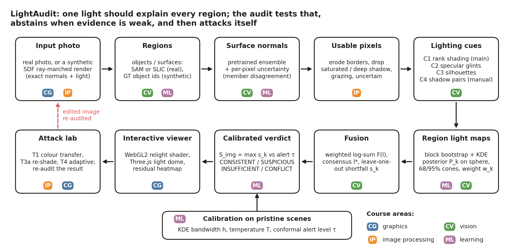

*I1. Pipeline: photo, regions, normals, cues, region maps, fusion with leave-one-out, calibrated verdict, viewer and attack.*

The full derivation is in [docs/METHOD.md](../docs/METHOD.md). In brief:

- **Conventions.** Camera space with +x right, +y up, +z toward the viewer; all direction maps live on one
  128 x 64 equirectangular grid shared by Python and JavaScript.
- **C1, shading.** Default (`Config.cue = "ls"`): the light maximises the Pearson correlation between
  `max(0, n.l)` and the linearised luminance `Y^2.2`. Original proposal, kept as the baseline (`cue = "rank"`):
  `Y = g(max(0, n.l))` for an unknown monotone `g`, light = maximiser of the Spearman correlation with all
  attached-shadow pixels tied.
  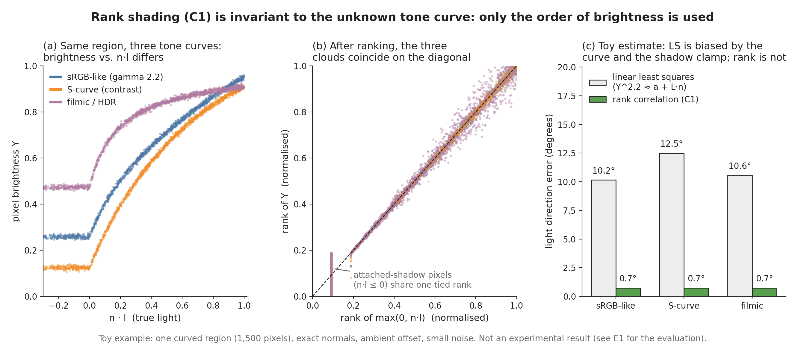

*I2. The rank cue ignores the tone curve.*
- **C2 glints, C3 silhouettes, C4 shadow pairs.**
  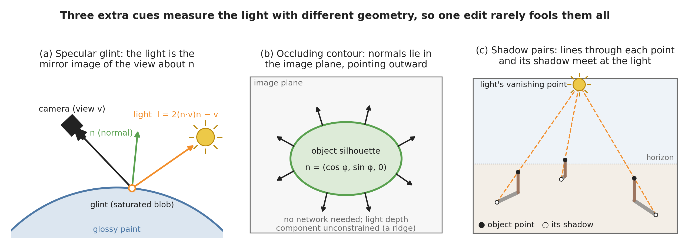

*I3. Geometry of the extra cues.*
- **Posterior.** 30 spatial block-bootstrap draws with smooth normal perturbation, a KDE on the sphere
  (bandwidth h, temperature T), 68% / 95% highest-density sets.
  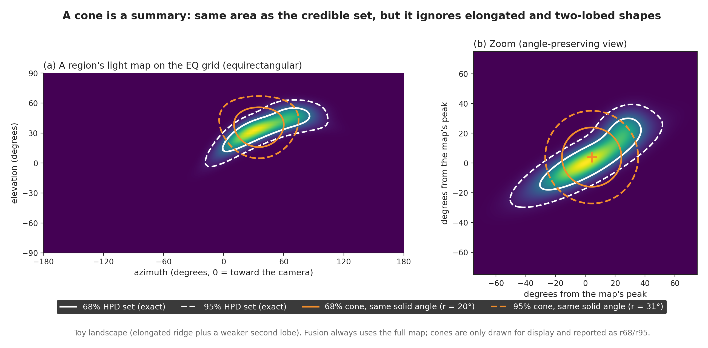

*I5. Credible sets and their cone summaries.*
- **Reliability.** Five factors (size, normal spread, sharpness, correlation strength, normal uncertainty)
  combined by a geometric mean; regions below 0.35 do not vote.
- **Fusion and verdict.** Weighted sum of log maps, leave-one-out consensus, shortfall
  `s_k = -ln(eps + A_k(l*_-k))`.
  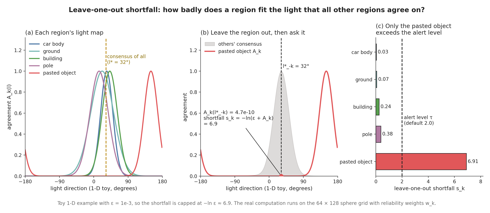

*I6. Leave-one-out consensus and shortfall.*
- **Two scene-level checks** (added after the first evaluation; METHOD.md section 8.1). *Soft light:* if the
  median shading contrast (P10/P90 of linearised luminance) of the reliable regions is above a calibrated
  threshold, the light is too diffuse to carry a direction and the verdict is INSUFFICIENT. *Panel residual:*
  in panel mode the ROI's brightness is predicted from the shading curve of the panel around it; a mean
  residual above a calibrated number of robust sigmas flags the ROI.
- **Calibration.** h and T are chosen for nominal coverage; the alarm level is the split-conformal quantile of
  pristine calibration scenes.
  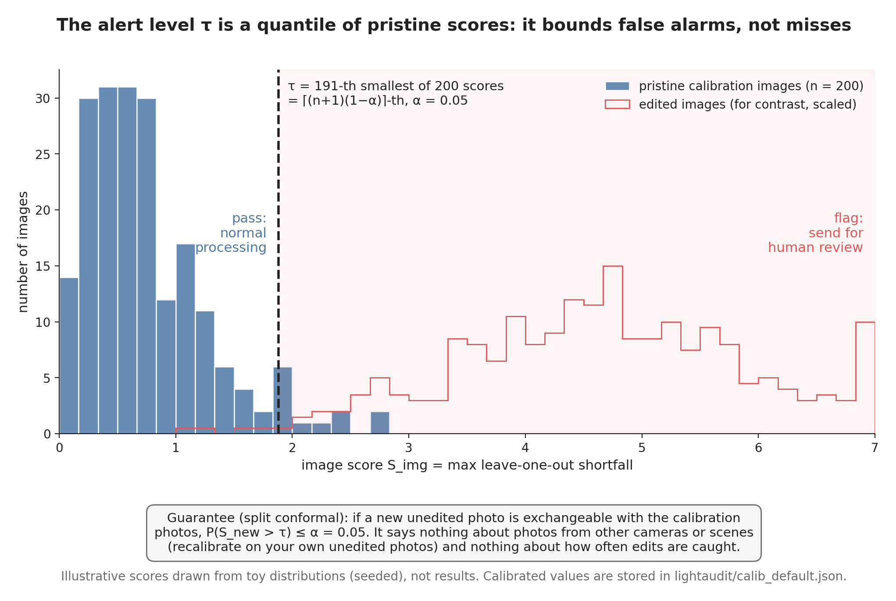

*I7. Conformal alarm level.*
- **Analysis by synthesis.** An isotonic fit predicts each region's brightness under the consensus light; the
  residual z-score is the heat map and the rescaled image is the counterfactual.

## 4 System

- `lightaudit/`: NumPy SDF ray-marcher for ground-truth scenes, the cues, posterior, fusion, calibration,
  attacks, bundle export, CLI and a FastAPI server with upload-and-audit.
- `viewer/`: static ES modules. A WebGL2 fragment shader re-lights the photo (Lambert via the fitted curve plus
  a Blinn-Phong or GGX highlight), draws the live residual and the counterfactual; a Three.js dome shows each
  region's map, the credible cones, the consensus and a draggable light; the fusion is re-run in the browser
  when regions are toggled (a parity test checks it against Python).

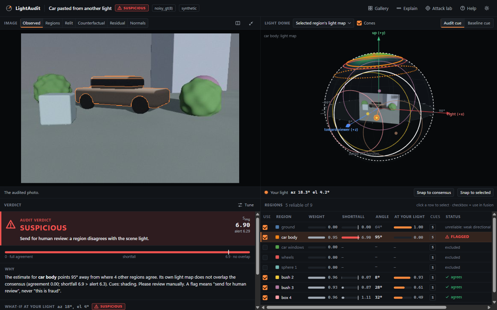

*Viewer: image view, light dome, verdict and region table (spliced-car demo).*

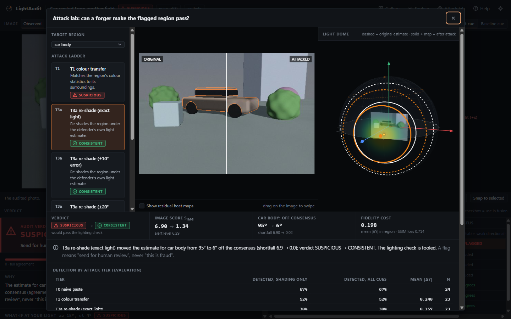

*Attack lab: original against attacked image, verdict before and after.*

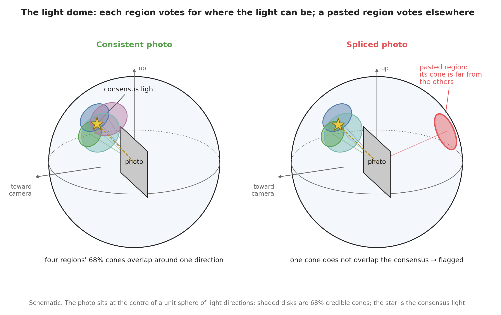

*I4. Reading the light dome.*

## 5 Experiments

Data: synthetic scenes (a car, 3 to 5 distractor objects, ground, optional building; random sun, tone curve,
noise, JPEG). Splits by seed: calibration 1000-1199, arbiter 2000-2199, test 3000-3299, demo 4000-4099.
Normals are the ground truth perturbed by spatially correlated noise of 8 degrees plus occasional gross patches.

### 5.1 Calibration (E3)

Calibration chose h = 14 degrees and T = 1.5; on the calibration split the 68% / 95% sets cover the true
light 0.70 / 0.90 of the time (473 reliable regions). The alarm level is
6.29 at alpha = 0.05 and 5.53 at alpha = 0.10; 17.0% of
pristine calibration scenes return INSUFFICIENT.

### T2 - E3 coverage on the test split

|  | h | T | cov68 | cov95 | mean r68 (deg) |
|---|---|---|---|---|---|
| before | 10.0 | 1.0 | 0.54 [0.38, 0.68] | 0.70 [0.62, 0.77] | 24.6 |
| after | 14.0 | 1.5 | 0.64 [0.56, 0.73] | 0.89 [0.82, 0.95] | 36.5 |

Suite quick, n = 56 reliable regions / 15 scenes. Caveat: synthetic scenes with simulated normal predictors unless stated.

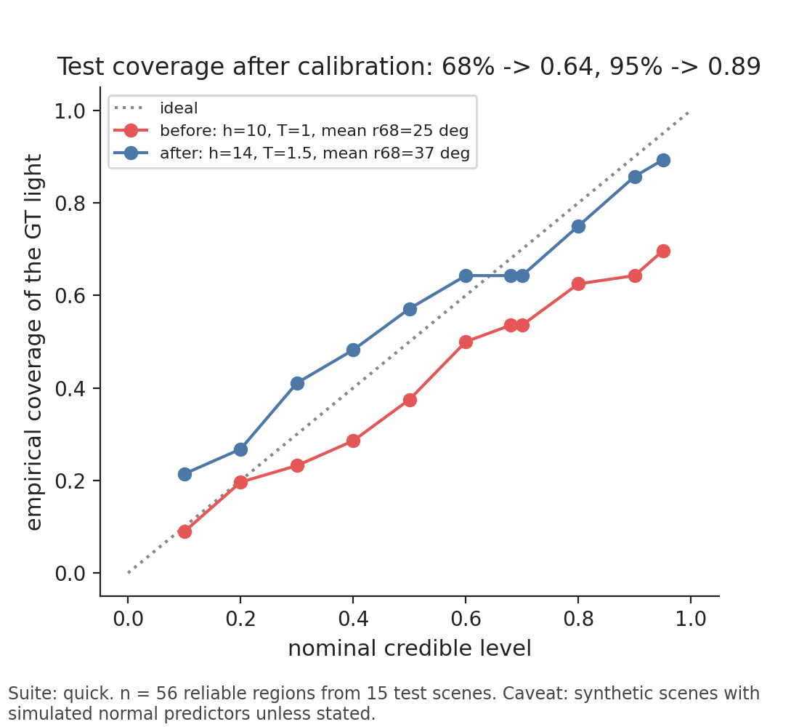

*F3. Reliability diagram on the test split.*

The soft-light threshold is 0.42 and the panel alert level is
nan (from 59 unedited damage scenes); the INSUFFICIENT rate
above includes the roughly 5% of sunny scenes that the soft-light test abstains on by construction.
These are the values for the least-squares cue. The alarm level is close to the maximum possible shortfall
(about 6.9): clean scenes often contain one region that disagrees strongly, so a 5% false-alarm rate forces a
high threshold. For comparison the rank cue calibrated to h = 18, T = 1.5 and an alarm level of 4.95
(`data/results_rank_quick/calib_rank.json`).

### 5.2 Cue accuracy under camera non-linearity (E1) - hypothesis H1 fails

### T1 - E1 median light error (deg) by tone curve

| tone curve | C1 rank | LS landscape | LS closed form | n regions |
|---|---|---|---|---|
| srgb | 21.6 [14.1, 31.5] | 7.6 [5.1, 12.5] | 29.7 | 59 |
| gamma1.8 | 24.8 [16.4, 32.7] | 6.0 [5.2, 9.4] | 37.1 | 60 |
| gamma2.6 | 22.9 [13.5, 30.2] | 6.7 [5.1, 12.3] | 28.8 | 59 |
| scurve | 25.8 [13.5, 39.0] | 7.3 [5.9, 14.3] | 36.0 | 56 |
| filmic | 22.1 [16.3, 32.7] | 6.7 [5.7, 10.0] | 28.4 | 61 |

Suite quick, 15 scenes, exact normals, 95% bootstrap CI over scenes. Caveat: synthetic scenes with simulated normal predictors unless stated.

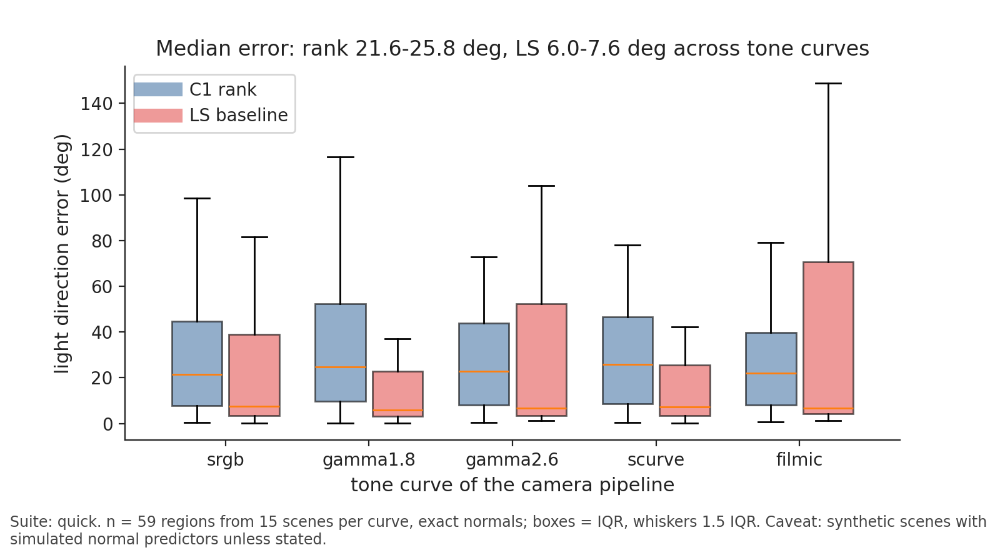

*F1. Light-direction error of the rank cue and the least-squares baseline per tone curve.*

The rank cue is stable across tone curves, as designed, but it is **several times less accurate than the
least-squares baseline on every curve**, including the non-linear ones. We checked this separately on 39 regions
with exact normals (median error 26.8 degrees for rank against 8.3 for least squares) and tried weighting the
rank correlation toward bright pixels, which did not help. Our explanation: ranks discard the *magnitude* of
brightness differences. For shapes with few distinct normals (the box-like car, buildings) many light directions
produce the same ordering of the faces, so the rank landscape has a wide plateau, whereas the least-squares fit
uses the brightness ratios between faces. The tone curves in the test set are mild enough that assuming gamma 2.2
costs the baseline little. The tone-curve invariance is real, but in this benchmark it does not pay for itself.
**Consequence: least squares became the default cue.** A separate 40-scene check on the calibration split gave
an AUC of about 0.83 for a car pasted from 90 degrees away with least squares against 0.75 with the rank cue
(about 0.66 for both at 45 degrees). The price is that least squares is not invariant to monotone brightness
changes: in the spliced-car demo a plain colour transfer now lowers the car's shortfall below the alarm level.

### 5.3 Normal quality (E2)

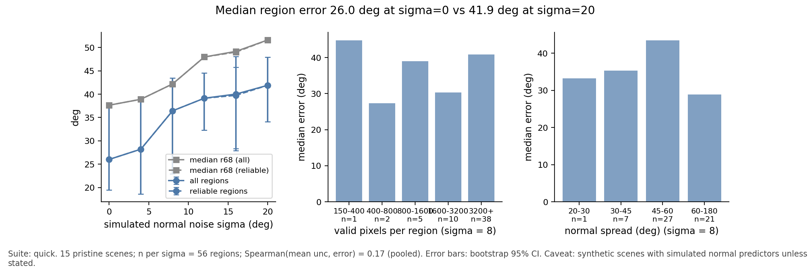

*F2. Error against simulated normal noise, region size and normal spread.*

### 5.4 Detection (E4, E5)

### T3 - E4/E5 detection by target and cue set

| target | cues | MDI@5%FPR (deg) | MDI@tau (deg) | TPR@5%FPR d=90 | FPR@tau | AUC d>=30 | top-1 loc. | n pos per delta / n neg |
|---|---|---|---|---|---|---|---|---|
| car | C1 | 135 | 135 | 0.40 [0.20, 0.80] | 0.00 | 0.63 [0.45, 0.80] | 0.78 | 15/15 |
| car | C1+C2 | 60 | 90 | 0.60 [0.33, 0.80] | 0.00 | 0.65 [0.47, 0.82] | 0.77 | 15/15 |
| car | C1+C2+C3 | 60 | 90 | 0.60 [0.33, 0.80] | 0.00 | 0.65 [0.47, 0.82] | 0.77 | 15/15 |
| car | RANK | n/a | n/a | 0.40 [0.13, 0.67] | 0.00 | 0.57 [0.39, 0.73] | 0.52 | 15/15 |
| distractor | C1 | 90 | n/a | 0.60 [0.33, 0.87] | 0.00 | 0.61 [0.48, 0.73] | 0.52 | 15/15 |
| distractor | C1+C2 | 90 | n/a | 0.60 [0.33, 0.87] | 0.00 | 0.62 [0.48, 0.75] | 0.51 | 15/15 |
| distractor | C1+C2+C3 | 90 | n/a | 0.60 [0.33, 0.87] | 0.00 | 0.62 [0.48, 0.75] | 0.51 | 15/15 |
| dent | C1 | n/a | 90 | 0.07 [0.00, 0.27] | 0.07 | 0.41 [0.22, 0.61] | 0.57 | 15/15 |
| dent | C1+C2 | n/a | 90 | 0.07 [0.00, 0.27] | 0.07 | 0.42 [0.22, 0.61] | 0.60 | 15/15 |
| dent | C1+C2+C3 | n/a | 90 | 0.07 [0.00, 0.27] | 0.07 | 0.42 [0.22, 0.61] | 0.60 | 15/15 |

Suite quick. 5%FPR threshold from the pristine TEST scores (labelled as such); tau = calibrated. 'fused' = C1+C2+C3: the shadow-pair cue C4 is manual-only (clicked in the viewer), so no automatic experiment can include it; 'fused' is therefore identical to C1+C2+C3. Caveat: synthetic scenes with simulated normal predictors unless stated.

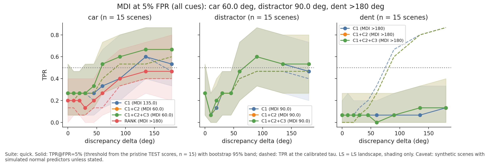

*F4. Detection rate against the discrepancy angle, per cue set.*

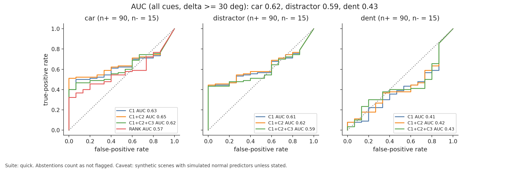

*F5. ROC curves, discrepancy of 30 degrees or more against pristine.*

In this table C1 is the default least-squares shading cue and RANK is the rank-cue baseline. Detection is
modest: a pasted car or distractor needs a discrepancy of roughly 60 to 135 degrees to reach 50% detection at 5%
false alarms, and the rank baseline is worse than least squares. For dents the AUC column (which scores only
the direction test) stays at chance, but the verdict now also uses the panel comparison: see the MDI@tau
column here and the dent rows of the attack table, where a naively pasted dent is flagged in 5 of 8 cases. Adding the glint cue
helps a little in this sample; adding the silhouette cue does not. With 15 scenes per cell these differences are
within the confidence intervals; read the exact values from the table.

### 5.5 Abstention and hard conditions (E6)

### T4 - E6 verdict distribution by condition

| condition | set | n | CONSISTENT | SUSPICIOUS | INSUFFICIENT | CONFLICT | accuracy (decided) |
|---|---|---|---|---|---|---|---|
| normal | pristine | 5 | 1.00 | 0.00 | 0.00 | 0.00 | 1.00 [1.00, 1.00] |
| normal | spliced | 5 | 0.20 | 0.80 | 0.00 | 0.00 | 0.80 [0.40, 1.00] |
| overcast | pristine | 5 | 0.20 | 0.00 | 0.80 | 0.00 | 1.00 [1.00, 1.00] |
| overcast | spliced | 5 | 0.00 | 0.20 | 0.80 | 0.00 | 1.00 [1.00, 1.00] |
| multi | pristine | 5 | 0.60 | 0.00 | 0.40 | 0.00 | 1.00 [1.00, 1.00] |
| multi | spliced | 5 | 0.60 | 0.20 | 0.20 | 0.00 | 0.25 [0.00, 0.75] |
| lowres | pristine | 5 | 0.60 | 0.00 | 0.40 | 0.00 | 1.00 [1.00, 1.00] |
| lowres | spliced | 5 | 0.20 | 0.20 | 0.60 | 0.00 | 0.50 [0.00, 1.00] |

Suite quick. Spliced = car at 90 deg. Caveat: synthetic scenes with simulated normal predictors unless stated.

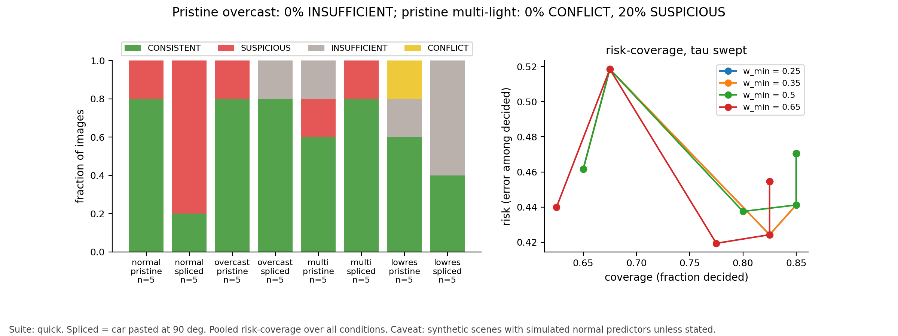

*F6. Verdict distribution by condition.*

Overcast scenes are now mostly sent to INSUFFICIENT by the soft-light test (before it was added none were:
soft sky light shades a surface almost like a broad light from above, so the direction test finds a consistent
"up"). The cost is that a splice under overcast light is not examined at all. Two-sun scenes are still not
recognised: they rarely produce CONFLICT, and a test for a second light source that we tried did not separate
them from one-sun scenes (AUC 0.65 on 30 + 30 calibration scenes), so it was left out.

### 5.6 Robustness (E7)

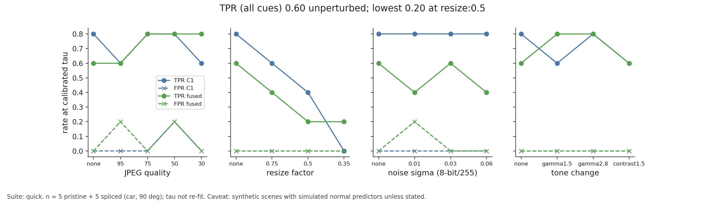

*F7. Detection and false alarms under JPEG, resize and noise. The threshold is not re-fitted.*

Down-scaling the image hurts most: detection drops sharply at every resize factor tested.

### 5.7 Ablations (E8)

### T5 - E8 ablations (car target)

| ablation | AUC d>=30 | TPR@5%FPR d=90 | MDI (deg) | abstain pristine | abstain composites |
|---|---|---|---|---|---|
| rule, C1 (shading) | 0.63 [0.52, 0.73] | 0.40 [0.20, 0.80] | 135 | 0.13 | 0.21 |
| rule, C1+C2 | 0.65 [0.54, 0.74] | 0.60 [0.33, 0.87] | 60 | 0.13 | 0.21 |
| rule, default (silhouette weight 0, same as C1+C2) | 0.65 [0.54, 0.74] | 0.60 [0.33, 0.87] | 60 | 0.13 | 0.21 |
| with silhouette cue (w_contour = 0.5) | 0.62 [0.50, 0.72] | 0.40 [0.20, 0.67] | 135 | 0.13 | 0.21 |
| RANK baseline (shading) | 0.57 [0.46, 0.69] | 0.40 [0.13, 0.67] | n/a | 0.13 | 0.20 |
| KDE calibration off (h=10, T=1) | 0.66 [0.55, 0.76] | 0.40 [0.20, 0.67] | 135 | 0.13 | 0.20 |
| w_min = 0.25 | 0.65 [0.54, 0.74] | 0.60 [0.33, 0.87] | 60 | 0.13 | 0.21 |
| w_min = 0.50 | 0.65 [0.54, 0.74] | 0.60 [0.33, 0.87] | 60 | 0.13 | 0.21 |
| no leave-one-out (global consensus) | 0.60 [0.48, 0.71] | 0.33 [0.13, 0.67] | 180 | 0.13 | 0.21 |
| arbiter (default cues) | 0.65 [0.54, 0.75] | 0.53 [0.27, 0.80] | 90 | 0.13 | 0.21 |
| region backend gt | 0.78 | TPR@tau 0.67, FPR@tau 0.00 | - | 0.00 | 0.00 |
| region backend slic | 0.78 | TPR@tau 0.00, FPR@tau 0.00 | - | 0.67 | 0.33 |

Suite quick; region-backend rows on 3+3 scenes. Caveat: synthetic scenes with simulated normal predictors unless stated.

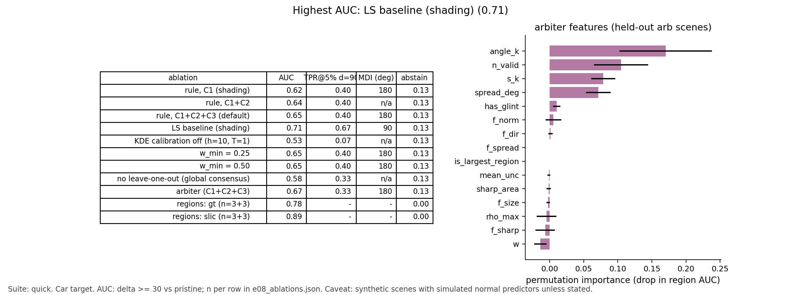

*F9. Ablations and arbiter feature importance.*

Calibrating the posterior shape and the leave-one-out test both help; the reliability floor barely matters; the
gradient-boosted arbiter is not better than the explainable rule in this sample.

### 5.8 Real normal predictor in the loop (E10)

A smoke test on 2 scenes, not a measurement; see `data/results/e10_real_normals.json` for what ran.

### 5.9 Real photos (qualitative)

Six unedited outdoor car photos from Wikimedia Commons and one splice made from them (a rectangle of one photo
pasted into another, audited with the paste mask as the region of interest). SAM regions, DSINE + Depth
Anything normal ensemble, alarm level calibrated on synthetic scenes only:

| bundle | normals | regions | regions found | reliable | verdict | image score |
|---|---|---|---|---|---|---|
| real_airfield_car | dsine+depth_anything | sam | 13 | 7 | CONSISTENT | 3.53 |
| real_carpark_sunny | dsine+depth_anything | sam | 26 | 6 | CONSISTENT | 3.57 |
| real_mini_parking | dsine+depth_anything | sam | 26 | 10 | SUSPICIOUS | 6.89 |
| real_peugeot_104 | dsine+depth_anything | sam | 38 | 18 | SUSPICIOUS | 6.91 |
| real_splice_carpark_sunny_from_peugeot_104 | dsine+depth_anything | sam | 26 | 5 | CONSISTENT | 3.01 |
| real_street_car | dsine+depth_anything | sam | 20 | 10 | SUSPICIOUS | 6.64 |
| real_supermarket_carpark | dsine+depth_anything | sam | 17 | 7 | SUSPICIOUS | 6.80 |

Among the six unedited photos one is flagged (a false alarm); with the earlier rank cue and a single normal
estimator four of the six were flagged. The splice (`real_splice_*`), which the earlier configuration flagged,
is **not** flagged now. So the current settings are quieter on real photos but also miss the one real splice we
tried. Seven images prove nothing either way: real-photo use needs a recalibration on real unedited photos
(`tools/calibrate_on_folder.py`) and a proper test set.

## 6 Attack evaluation and discussion

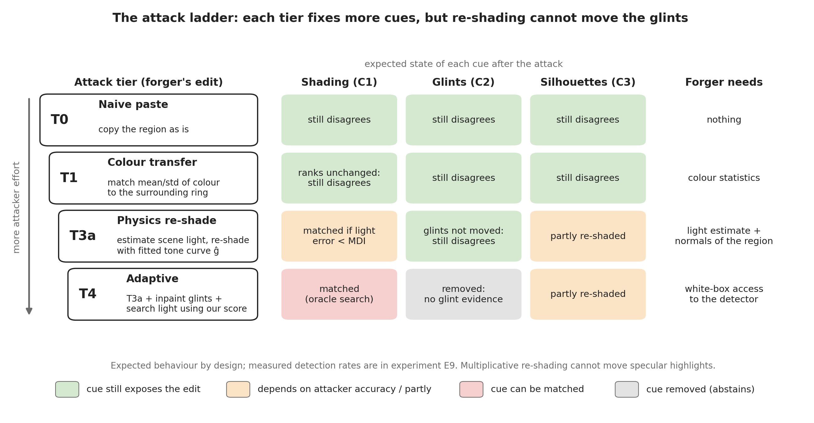

*I8. Attack tiers and what each can move.*

| tier | n | detected, shading only | detected, all cues | mean abs dY |
|---|---|---|---|---|
| T0 naive paste | 24 | 0.67 | 0.67 | - |
| T1 colour transfer | 23 | 0.52 | 0.52 | 0.240 |
| T3a re-shade (exact light) | 23 | 0.30 | 0.30 | 0.157 |
| T3a re-shade (±5° error) | 23 | 0.30 | 0.30 | 0.156 |
| T3a re-shade (±10° error) | 23 | 0.30 | 0.26 | 0.154 |
| T3a re-shade (±20° error) | 23 | 0.30 | 0.30 | 0.148 |
| T3a re-shade (±40° error) | 23 | 0.30 | 0.30 | 0.135 |
| T3a re-shade (exact light, independent normals) | 23 | 0.26 | 0.26 | 0.159 |
| T3a re-shade (±5° error, independent normals) | 23 | 0.30 | 0.30 | 0.158 |
| T3a re-shade (±10° error, independent normals) | 23 | 0.26 | 0.26 | 0.154 |
| T3a re-shade (±20° error, independent normals) | 23 | 0.30 | 0.30 | 0.151 |
| T3a re-shade (±40° error, independent normals) | 23 | 0.30 | 0.30 | 0.135 |
| T4 adaptive (white box) | 23 | 0.30 | 0.30 | 0.164 |

Suite: quick. Synthetic scenes, simulated normals that do not react to the edit (best case for the attacker); detection = SUSPICIOUS at the calibrated tau; pooled over car, distractor and dent targets (delta 90-135 deg); suite 'quick'.

### T6 - E9 attacks

| tier | target | n | TPR@tau C1 | TPR@tau all cues | defence recovery | TPR@5%FPR all cues | mean |dY| | 1-SSIM |
|---|---|---|---|---|---|---|---|---|
| T0 naive paste | car | 8 | 0.75 | 0.75 | 0.00 | 0.75 | n/a | n/a |
| T0 naive paste | distractor | 8 | 0.62 | 0.62 | 0.00 | 0.62 | n/a | n/a |
| T0 naive paste | dent | 8 | 0.62 | 0.62 | 0.00 | 0.12 | n/a | n/a |
| T0 naive paste | all | 24 | 0.67 | 0.67 | 0.00 | 0.50 | n/a | n/a |
| T1 colour transfer | car | 8 | 0.88 | 0.88 | 0.00 | 0.88 | 0.190 | 0.253 |
| T1 colour transfer | distractor | 7 | 0.71 | 0.71 | 0.00 | 0.71 | 0.180 | 0.188 |
| T1 colour transfer | dent | 8 | 0.00 | 0.00 | 0.00 | 0.00 | 0.342 | 0.506 |
| T1 colour transfer | all | 23 | 0.52 | 0.52 | 0.00 | 0.52 | 0.240 | 0.321 |
| T3a re-shade (exact light) | car | 8 | 0.00 | 0.00 | 0.00 | 0.00 | 0.194 | 0.486 |
| T3a re-shade (exact light) | distractor | 7 | 0.14 | 0.14 | 0.00 | 0.14 | 0.228 | 0.537 |
| T3a re-shade (exact light) | dent | 8 | 0.75 | 0.75 | 0.00 | 0.00 | 0.059 | 0.192 |
| T3a re-shade (exact light) | all | 23 | 0.30 | 0.30 | 0.00 | 0.04 | 0.157 | 0.399 |
| T3a re-shade (±5° error) | car | 8 | 0.00 | 0.00 | 0.00 | 0.00 | 0.191 | 0.475 |
| T3a re-shade (±5° error) | distractor | 7 | 0.14 | 0.14 | 0.00 | 0.14 | 0.229 | 0.535 |
| T3a re-shade (±5° error) | dent | 8 | 0.75 | 0.75 | 0.00 | 0.00 | 0.058 | 0.188 |
| T3a re-shade (±5° error) | all | 23 | 0.30 | 0.30 | 0.00 | 0.04 | 0.156 | 0.393 |
| T3a re-shade (±10° error) | car | 8 | 0.00 | 0.00 | 0.00 | 0.00 | 0.188 | 0.471 |
| T3a re-shade (±10° error) | distractor | 7 | 0.14 | 0.00 | -0.14 | 0.14 | 0.224 | 0.525 |
| T3a re-shade (±10° error) | dent | 8 | 0.75 | 0.75 | 0.00 | 0.00 | 0.060 | 0.194 |
| T3a re-shade (±10° error) | all | 23 | 0.30 | 0.26 | -0.04 | 0.04 | 0.154 | 0.391 |
| T3a re-shade (±20° error) | car | 8 | 0.00 | 0.00 | 0.00 | 0.00 | 0.184 | 0.446 |
| T3a re-shade (±20° error) | distractor | 7 | 0.14 | 0.14 | 0.00 | 0.14 | 0.208 | 0.522 |
| T3a re-shade (±20° error) | dent | 8 | 0.75 | 0.75 | 0.00 | 0.00 | 0.058 | 0.186 |
| T3a re-shade (±20° error) | all | 23 | 0.30 | 0.30 | 0.00 | 0.04 | 0.148 | 0.379 |
| T3a re-shade (±40° error) | car | 8 | 0.00 | 0.00 | 0.00 | 0.00 | 0.170 | 0.438 |
| T3a re-shade (±40° error) | distractor | 7 | 0.14 | 0.14 | 0.00 | 0.14 | 0.189 | 0.448 |
| T3a re-shade (±40° error) | dent | 8 | 0.75 | 0.75 | 0.00 | 0.00 | 0.053 | 0.181 |
| T3a re-shade (±40° error) | all | 23 | 0.30 | 0.30 | 0.00 | 0.04 | 0.135 | 0.352 |
| T3a re-shade (exact light, independent normals) | car | 8 | 0.00 | 0.00 | 0.00 | 0.00 | 0.192 | 0.488 |
| T3a re-shade (exact light, independent normals) | distractor | 7 | 0.14 | 0.14 | 0.00 | 0.14 | 0.224 | 0.511 |
| T3a re-shade (exact light, independent normals) | dent | 8 | 0.62 | 0.62 | 0.00 | 0.00 | 0.068 | 0.205 |
| T3a re-shade (exact light, independent normals) | all | 23 | 0.26 | 0.26 | 0.00 | 0.04 | 0.159 | 0.397 |
| T3a re-shade (±5° error, independent normals) | car | 8 | 0.00 | 0.00 | 0.00 | 0.00 | 0.189 | 0.471 |
| T3a re-shade (±5° error, independent normals) | distractor | 7 | 0.14 | 0.14 | 0.00 | 0.14 | 0.226 | 0.507 |
| T3a re-shade (±5° error, independent normals) | dent | 8 | 0.75 | 0.75 | 0.00 | 0.00 | 0.067 | 0.202 |
| T3a re-shade (±5° error, independent normals) | all | 23 | 0.30 | 0.30 | 0.00 | 0.04 | 0.158 | 0.388 |
| T3a re-shade (±10° error, independent normals) | car | 8 | 0.00 | 0.00 | 0.00 | 0.00 | 0.186 | 0.473 |
| T3a re-shade (±10° error, independent normals) | distractor | 7 | 0.14 | 0.14 | 0.00 | 0.14 | 0.215 | 0.502 |
| T3a re-shade (±10° error, independent normals) | dent | 8 | 0.62 | 0.62 | 0.00 | 0.00 | 0.068 | 0.209 |
| T3a re-shade (±10° error, independent normals) | all | 23 | 0.26 | 0.26 | 0.00 | 0.04 | 0.154 | 0.390 |
| T3a re-shade (±20° error, independent normals) | car | 8 | 0.00 | 0.00 | 0.00 | 0.00 | 0.185 | 0.443 |
| T3a re-shade (±20° error, independent normals) | distractor | 7 | 0.14 | 0.14 | 0.00 | 0.29 | 0.207 | 0.497 |
| T3a re-shade (±20° error, independent normals) | dent | 8 | 0.75 | 0.75 | 0.00 | 0.00 | 0.069 | 0.206 |
| T3a re-shade (±20° error, independent normals) | all | 23 | 0.30 | 0.30 | 0.00 | 0.09 | 0.151 | 0.377 |
| T3a re-shade (±40° error, independent normals) | car | 8 | 0.00 | 0.00 | 0.00 | 0.00 | 0.169 | 0.438 |
| T3a re-shade (±40° error, independent normals) | distractor | 7 | 0.14 | 0.14 | 0.00 | 0.14 | 0.188 | 0.441 |
| T3a re-shade (±40° error, independent normals) | dent | 8 | 0.75 | 0.75 | 0.00 | 0.00 | 0.057 | 0.189 |
| T3a re-shade (±40° error, independent normals) | all | 23 | 0.30 | 0.30 | 0.00 | 0.04 | 0.135 | 0.352 |
| T4 adaptive (white box) | car | 8 | 0.00 | 0.00 | 0.00 | 0.00 | 0.188 | 0.473 |
| T4 adaptive (white box) | distractor | 7 | 0.14 | 0.14 | 0.00 | 0.14 | 0.231 | 0.536 |
| T4 adaptive (white box) | dent | 8 | 0.75 | 0.75 | 0.00 | 0.12 | 0.081 | 0.208 |
| T4 adaptive (white box) | all | 23 | 0.30 | 0.30 | 0.00 | 0.09 | 0.164 | 0.400 |

Suite quick. the defender's simulated normals are independent of the edit (best case for the attacker); an attacked region that becomes not assessable counts as passing. Caveat: synthetic scenes with simulated normal predictors unless stated.

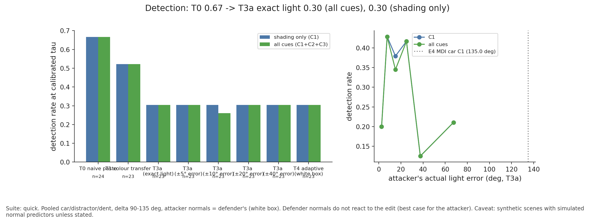

*F8. Detection by attack tier, shading only against all cues.*

Colour and brightness harmonisation (T1) leaves the pooled detection rate about where it was, although with the
least-squares cue it can flip individual cases (the spliced-car demo passes after colour transfer; the rank cue
was immune to that by construction). A physics re-shade (T3a) of a whole object (car, distractor) defeats the detector almost completely, even when
the forger's estimate of the scene light is 20 degrees off, and the highlight and silhouette cues recover only a
few percent. Pasted dents behave differently: the panel comparison keeps flagging them after T3a and T4,
because re-shading the dent with its own curve does not make it match the panel around it. The re-shade changes the region's brightness noticeably (see the mean |dY| column), which is the
forger's cost. Caveat: the defender's simulated normals do not react to the edit, the best case for the attacker.

## 7 Limitations and ethics

> **What LightAudit can and cannot do.** LightAudit checks whether the lighting of different parts of a photo is physically consistent. It does **not** detect AI-generated images in general: a generator that produces the whole picture in one pass usually gives every object the same plausible light. A careful forger who re-lights an edited region to match the scene can pass the shading check (the attack lab measures exactly how much extra work that takes). Real photos can be flagged wrongly when they contain several lights, strong reflections, or bad surface-direction estimates, and many real photos (overcast, indoor, heavily filtered, tiny or flat objects) carry too little lighting evidence, in which case LightAudit says "insufficient evidence". Surface directions come from pretrained neural networks and are learned guesses, not measurements. The alert threshold controls the false-alarm rate only for photos like those used for calibration. **A flag means "send for human review", never "this is fraud".** Results on synthetic scenes do not automatically transfer to real photos; real-photo results are qualitative unless stated.

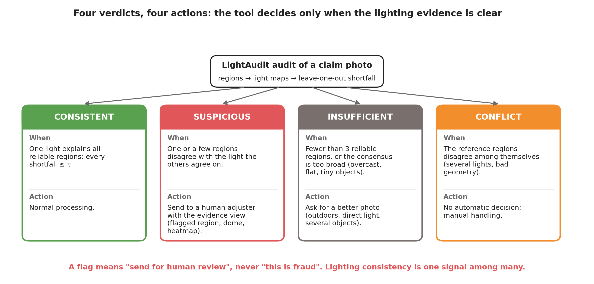

*I9. The four verdicts and the recommended action.*

Further limits found in this work: the rank cue we proposed loses to a simple least-squares fit; the alarm level
that keeps false alarms at 5% on synthetic scenes misses many splices; a dent that faces away from both lights
looks the same under either and cannot be detected; two-light scenes are not recognised; under diffuse light
the tool abstains, so nothing is checked. A tool like this must not
be used to accuse anyone: it produces one signal for a human reviewer.

## 8 Conclusion

We built a complete, inspectable lighting-consistency auditor with an interactive 3D evidence viewer and a
self-attack lab, and evaluated it honestly. The viewer and the analysis-by-synthesis views do what they were
designed to do. The detector itself is modest: the rank cue we proposed was less accurate than least squares
and was replaced as the default, detection of whole pasted objects still needs large lighting discrepancies and
is defeated by re-shading, and real-photo behaviour is untested beyond seven images. The two checks added late,
soft-light abstention and the panel comparison for damage regions, fixed the two failures they target. The most
useful next steps are a full-size evaluation, calibration and testing on real photos, and a test for multiple
light sources.

## References

See [docs/LITERATURE.md](../docs/LITERATURE.md).

## Appendix: reproduction

- Hyperparameters: `lightaudit/config.py`; calibration: `lightaudit/calib_default.json`.
- Seeds: calibration 1000-1199, arbiter 2000-2199, test 3000-3299, demo 4000-4099.
- Commands: `setup.ps1`, then `run_all.ps1` (or `-Quick`); individual steps are listed in `README.md`.
- What was actually run, and every deviation from the build spec: `BUILD_LOG.md`.
